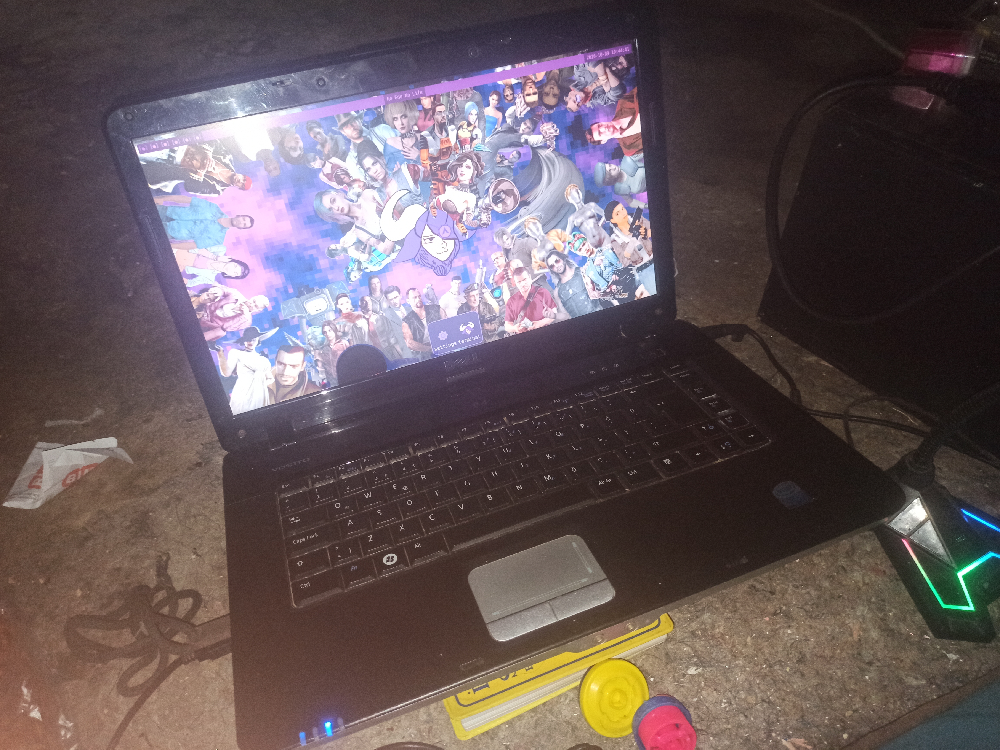
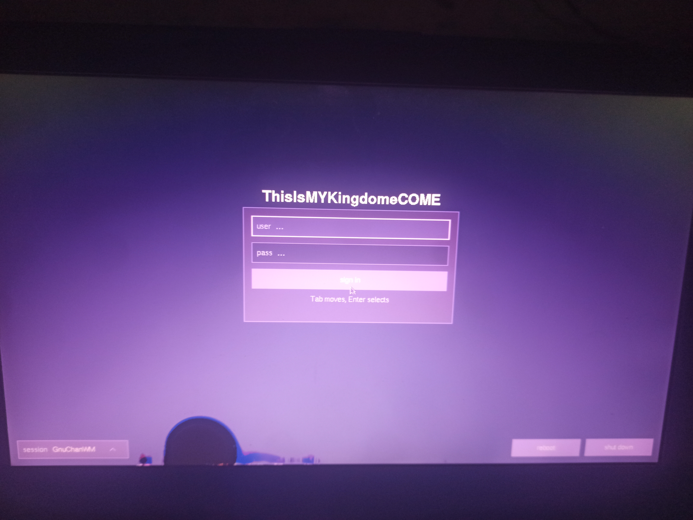
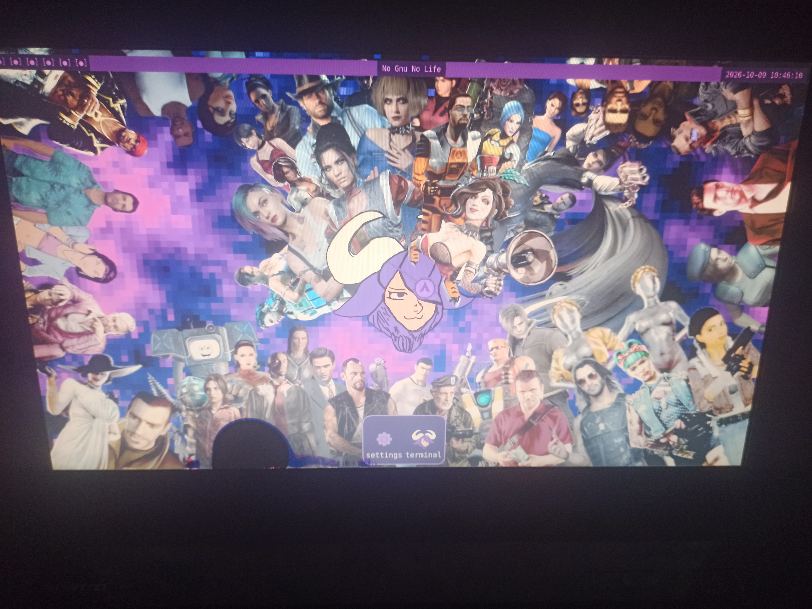
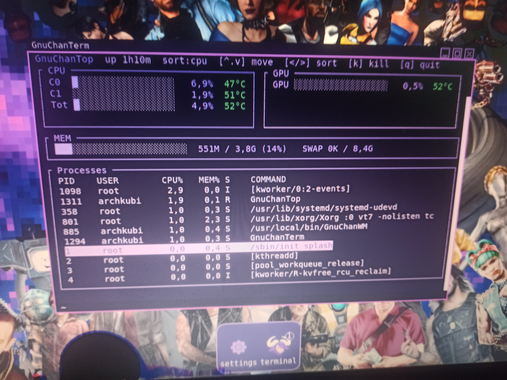
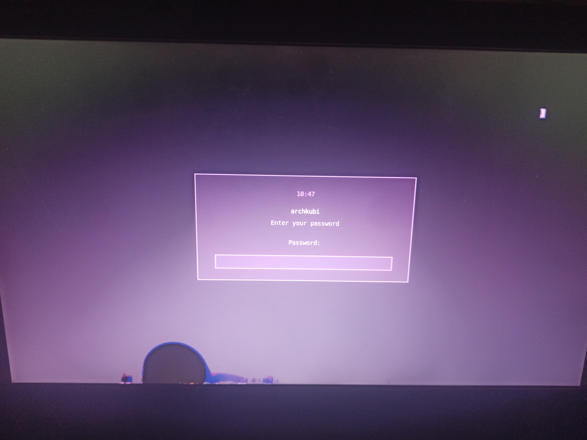
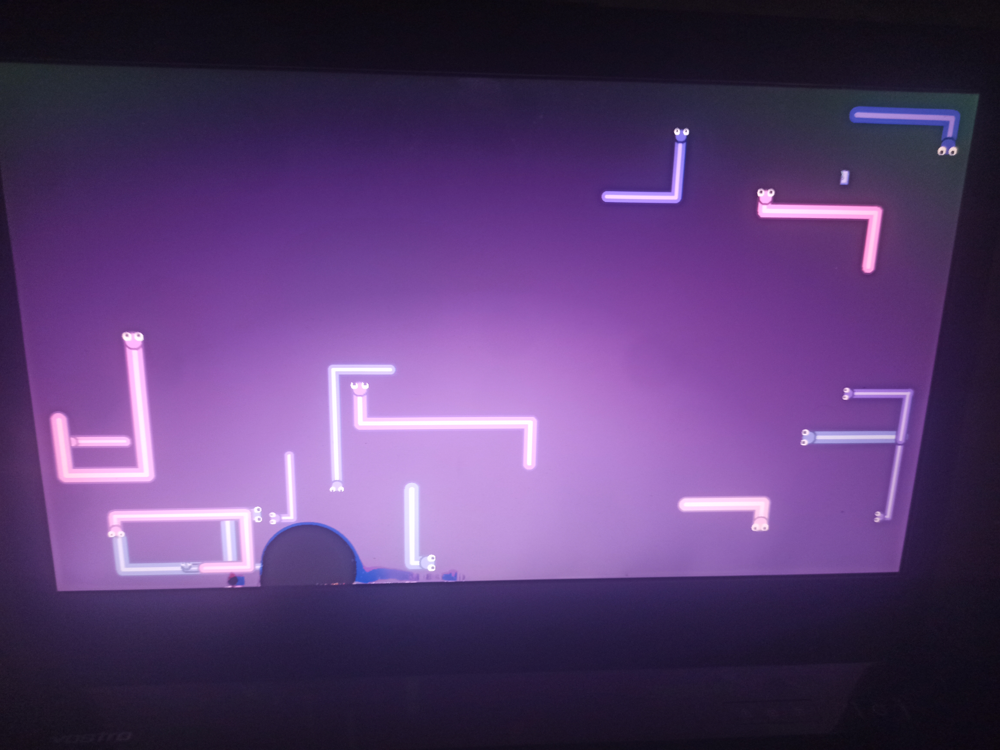
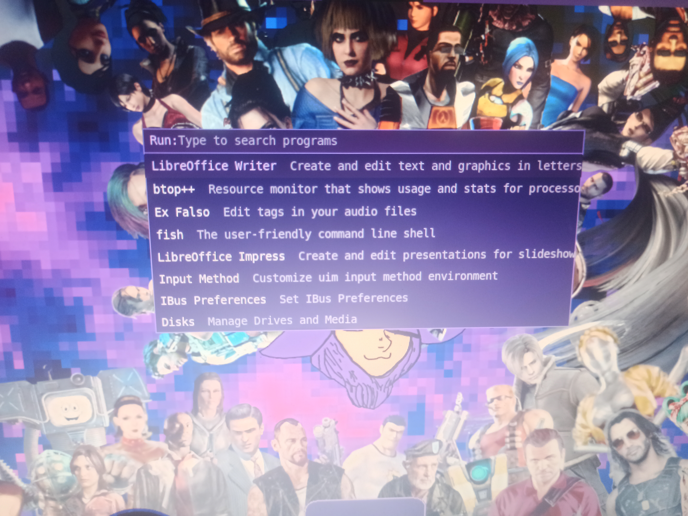
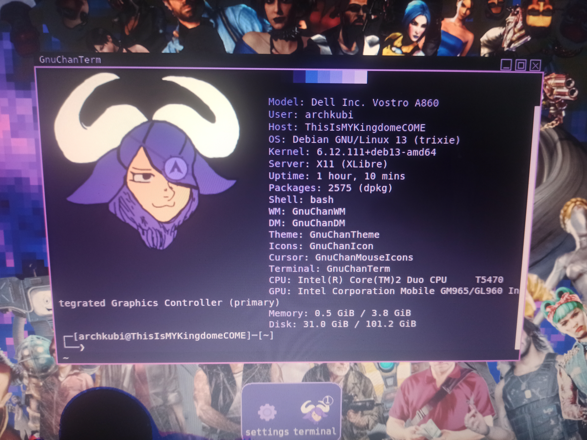
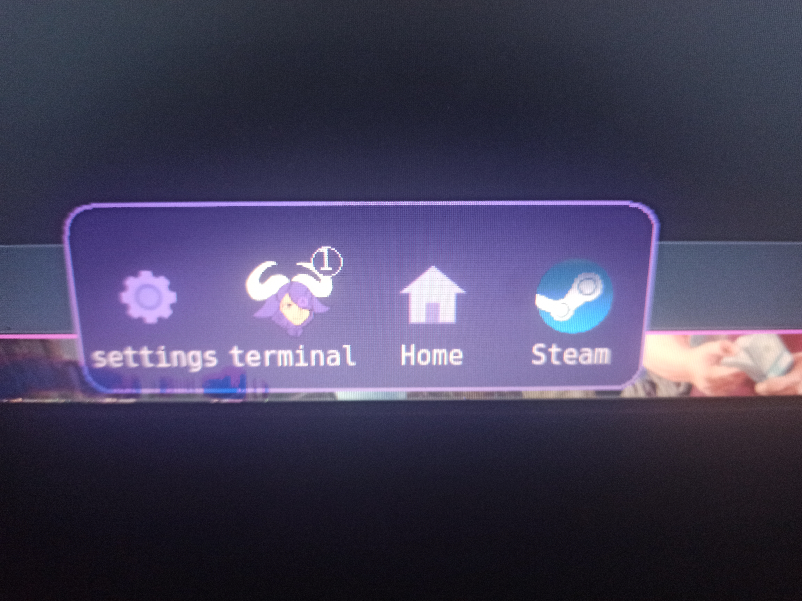
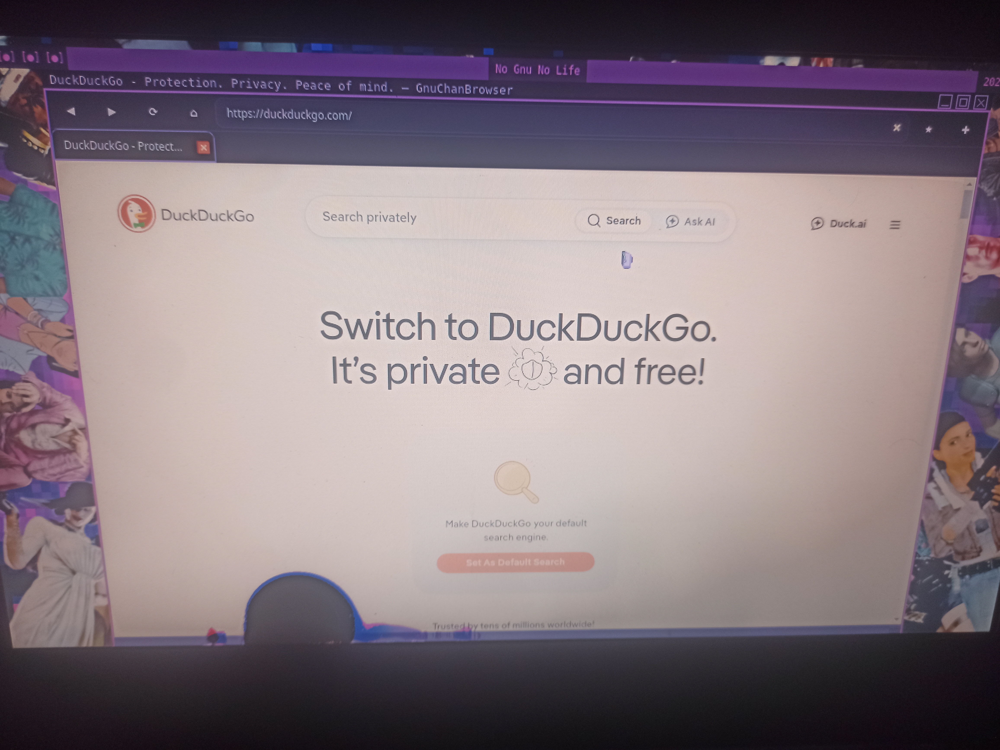

# GnuchanOS

# distro --> it's not ready

The surrounding operating-system distribution — shell environment, package set and
desktop — is **not ready**.

# Language And Platform -> Ready

The language and its graphics modules live in their own repository:
**[gcl](https://github.com/gnuchanos/gcl)** — see its
[README](https://github.com/gnuchanos/gcl/blob/main/README.md) and the
[language reference](https://github.com/gnuchanos/gcl/blob/main/src/readme.md).

- **[GCL](https://github.com/gnuchanos/gcl)** -> RAYLIB and RAYGUI native MODULE
  - EXTRA PYTHON EMBED SYSTEM -> PyRaylib and PyRaygui
  - EXTRA LUA EMBED SYSTEM -> LuaRaylib and LuaRaygui

# [GNUCHANOS Softwares]

Every program now lives in its own repository under
[github.com/gnuchanos](https://github.com/gnuchanos).

Tested on a very old computer: a Dell Vostro A860.

- **[GnuChanDM](https://github.com/gnuchanos/GnuChanDM)** --> GnuChan Display Manager is simple display manager
  
- **[GnuChanWM](https://github.com/gnuchanos/GnuChanWM)** --> GnuChan Window Manager is simple x11 Window Manager
  
- **[GnuChanTop](https://github.com/gnuchanos/GnuChanTop)** --> GnuChan Top is a simple system monitor
  
- **[GnuChanSL](https://github.com/gnuchanos/GnuChanLockScreen)** --> GnuChan Screen Lock is simple x11 Screen Lock
  
- **[GnuChanSS](https://github.com/gnuchanos/GnuChanSS)** --> GnuChan Screen Saver is simple x11 Screen Saver
  
- **[GnuChanRunner](https://github.com/gnuchanos/GnuChanRunner)** --> GnuChan Simple Program Runner like rofi
  
- **[GnuChanTerm](https://github.com/gnuchanos/GnuChanTerm)** --> GnuChan Terminal is simple xterm like terminal
- **[GnuChanFetch](https://github.com/gnuchanos/GnuChanFetch)** --> GnuChan Fetch is simple neofetch like program supports .png
  
- **[GnuChanDock](https://github.com/gnuchanos/GnuChanDock)** --> GnuChan Simple Dock program
  
- **[GnuChanBrowser](https://github.com/gnuchanos/GnuChanBrowser)** --> GnuChan Simple Qt Engine Browser
  
- **[GnuChanSettings](https://github.com/gnuchanos/GnuChanSettings)** --> GnuChan control panel
- **[GnuChanNotification](https://github.com/gnuchanos/GnuChanNotification)** --> GnuChan notification daemon
- **[GnuChanWifi](https://github.com/gnuchanos/GnuChanWifi)** --> GnuChan wifi manager, drives NetworkManager through nmcli
- **[GnuChanNetworkManager](https://github.com/gnuchanos/GnuChanNetworkManager)** --> GnuChan network manager: interfaces, DNS, DPI bypass

[GNUCHANOS DOTFILE](dotfile/)

- READY: GRUB THEME
- READY: GTK THEME
- READY: ICON THEME
- READY: MOUSE ICON THEME
- READY: PLYMOUTH THEME
- READY: TOUCHPAD SETTINGS
- READY: VOSTRO, X440WAK settings and fix

[SIMPLE INSTALL SCRIPT] [IT SIMPLE SCRIPT JUST INSTALLING PROGRAMS FIRST READ SCRIPT]

- [dotfile/Install_Software.py](dotfile/Install_Software.py)

[GNUCHANOS] [DISTRO STILL WORK IN PROGRESS]

--- 

[INFO]

# Username: gnuchanos
# Password: gnuchanos
